## Abstract

Compliant parallel grippers have been widely applied in industrial fields, including automation assembly, agriculture, and electronics, owing to their compliance and versatility. However, stiffness modeling and optimal design of compliant grippers remain a challenge due to the nonlinear force-motion behaviors of flexible materials with large deflections.

This work presents a comprehensive approach to establishing an analytical stiffness model for the analysis and optimization of a compliant gripper. Elastic beams of arbitrary initial curved geometry form a **flexible parallelogram mechanism (FPM)**, constituting a delicately designed planar compliant gripper with beneficial stiffness characteristics, including variable capability, axial and grasping decoupling, and a centrally located compliance center.

Based on the modeling, initial beam shapes are optimized to obtain pure or actively tuned passive compliance with a wide variation — **over 100× for grasping stiffness and over 500× for axial stiffness**. Finite element analysis and experiments based on elastic beams with distinct geometries and materials are carried out to validate the method. Finally, diverse grasping scenarios and a demonstration of the autonomous peg-into-hole task are accomplished, showcasing the performance and potential usage of the compliant gripper in industrial applications.

<center>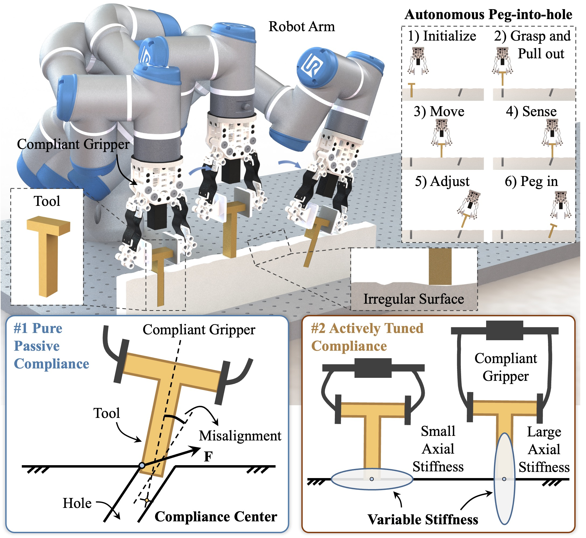</center>

## Background & Motivation

Parallel grippers are pivotal components in industry due to their stable grasping format and general adaptation to various workpieces and tools, widely used in autonomous assembly tasks. However, commercial parallel grippers — including FESTO, ROBOTIQ, and SCHUNK — are rigid, susceptible to collision damages caused by unstructured environments and inevitable position and orientation errors. Consequently, compliance is demanded to provide adaptation.

Existing stiffness modeling methods face a dilemma between accuracy and efficiency:
- Models like constant curvature, piecewise constant curvature, smooth curvature, and pseudo-rigid-body introduce postulated conditions at the sacrifice of accuracy
- Methods like piecewise linear strain and FEA obtain precise results with a heavy computational burden by solving partial differential equations (PDEs)

It remains a challenge to construct an accurate and efficient stiffness model for large-deflection elastic beams, assisting optimization design to meet various stiffness demands in practical industrial applications.

**Contributions of this work:**
1. Presented a general analytical stiffness modeling method for initially curved elastic beams and compliant grippers, balancing model accuracy and computational efficiency
2. Expressed initial beam shape based on Fourier descriptors and achieved geometry optimization for desired stiffness
3. Proposed a planar compliant gripper with FPM possessing decoupled stiffness and a central compliance center
4. Achieved passive compliance and an actively tuned stiffness variance range of over **500× in axial** and over **100× in grasping direction**, exceeding the existing maximum 70.9×

## Method

### Mechanical Design & Flexible Parallelogram Mechanism

The autonomous peg-into-hole assembly task with hole-position uncertainty requires grasping a tool, dragging along a given direction until reaching the hole location, and pegging into it. During the process, stiffness has to meet different requirements to ensure successful assembly.

The basic design concept leverages elastic beams of arbitrary initial curved geometry to form a **flexible parallelogram mechanism (FPM)**. FPM sets no limits to the elastic beams as long as they are identical and avoid mechanical interference. Since different geometry leads to distinct characteristics, the beam shape can be devised to satisfy desired stiffness requirements.

The elastic beams adopted are made of **carbon fiber (CF)**, **PLA**, or **spring steel (SS)** in curved shapes with a rectangular cross-section, such that the stiffness characteristics can be intentionally designed, besides being initiatively tuned.

<center>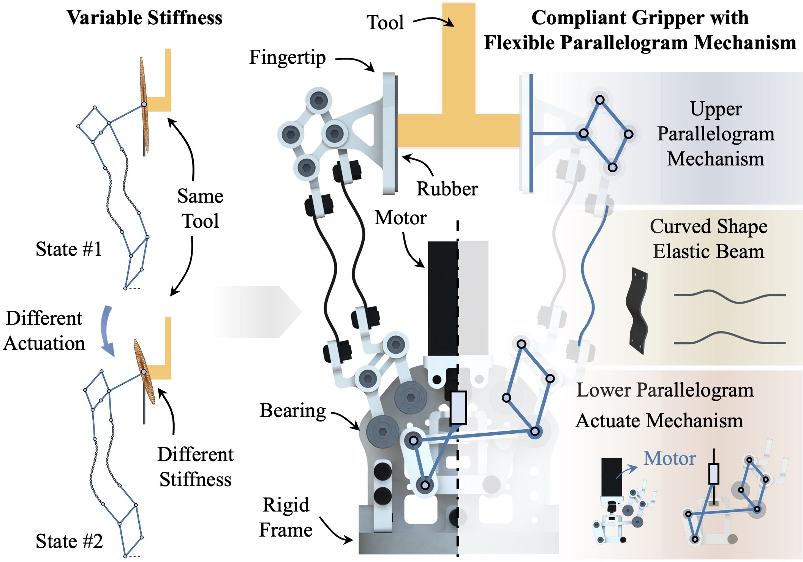</center>

### Kinetostatics Modeling of a Curved Elastic Beam

The nonlinear large deflection of a curved elastic beam can be analytically and efficiently modeled through an equivalent redundant serial mechanism. The elastic beam is discretized into n relatively short segments with equal arc length. Each segment can be kinematically equal to a serial mechanism with six DOFs.

For planar cases, the in-plane rotational stiffness within the plane is much smaller than the other stiffness components, leading to a further simplification for the equivalent segment as a **torsional spring connecting two links**, with the initial pose related to local curvature.

Consequently, beam deformation can be characterized by the motion of an equivalent hyper-redundant multi-body system composed of rigid linkages articulated with passive torsional spring joints. The **Product of Exponential formula** is used to solve the kinematics problem concisely and efficiently.

<center>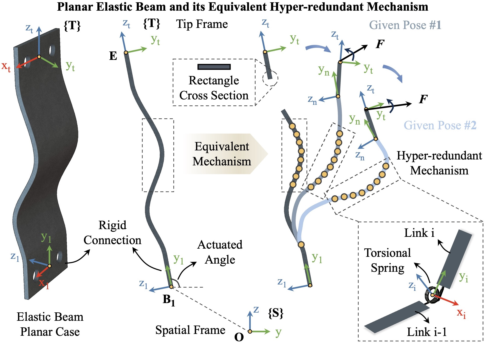</center>

### Kinetostatics Model of One Finger

Based on force-motion coordination, the kinetostatics model of one finger is established. Geometric constraints are imposed at the passive revolute joint connecting the elastic beam and the upper parallelogram mechanism. Meanwhile, propagated torques are balanced through elastic joints.

A normal case in parallel grasping is that only translational motions without rotation are imposed. Since the passive revolute joints only exert equivalent torque pairs, the solution yields identical deflection for the two beams, which is beneficial to parallel grasping.

<center>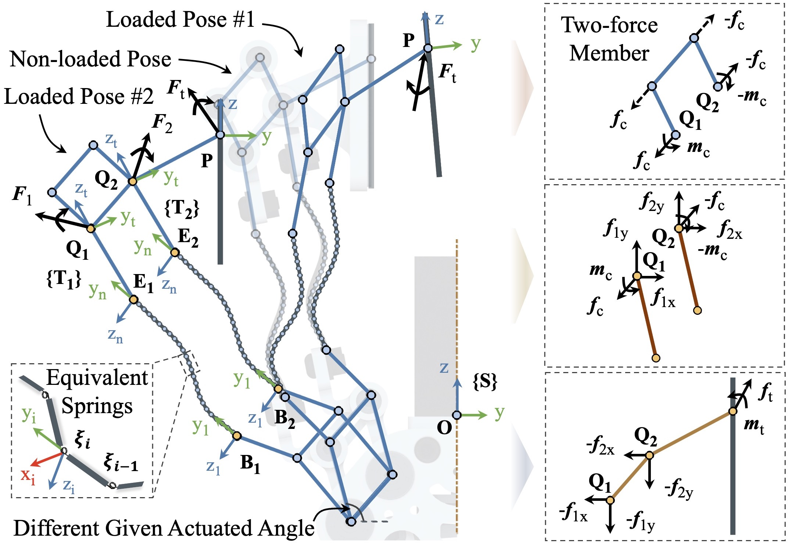</center>

### Stiffness Modeling & Decoupled Property

The stiffness model of a curved elastic beam is analytically established based on the kinetostatics framework using increment analysis. Small increments near the determined balanced state are introduced to analyze the stiffness characteristics.

By integrating force and motion coordination, the stiffness matrix of one flexible finger can be deduced. Furthermore, the **FPM Decoupled Property** is proven: the stiffness matrix of the flexible finger with FPM is decoupled for its rotational and translational components in the planar case. This beneficial property holds as long as the two beams are identical and the upper mechanism is a parallelogram.

For the whole compliant gripper, the rotational, axial, and grasping components are completely decoupled. The compliance center is fixed along the central line, allowing intuitive comparison of the relative position during assembly tasks and benefiting pure passive compliance design.

<center>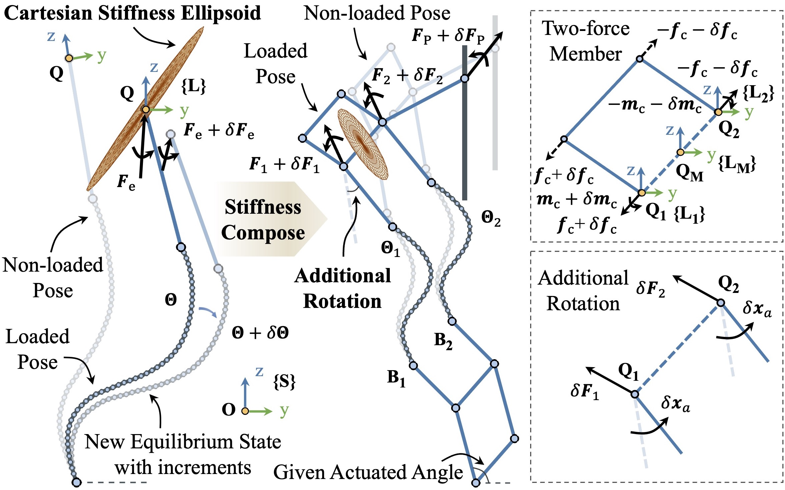</center>

<center>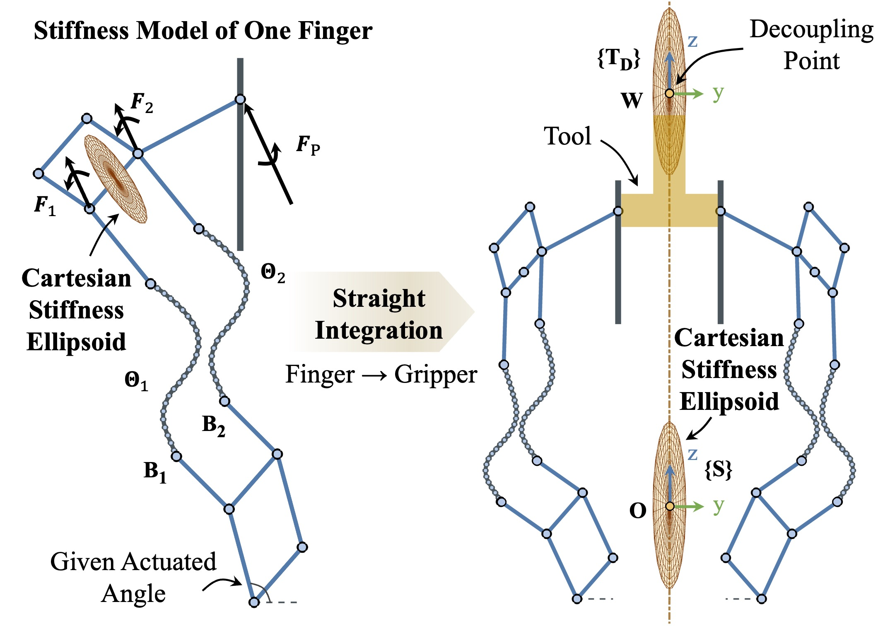</center>

## Optimization

### Beam Shape Optimization with Fourier Descriptors

The stiffness characteristics of the compliant gripper can be devised through initial beam geometry. A comprehensive mathematical expression of curves based on the **Fourier descriptor** is applied. A general planar arbitrary curve is normalized along the x-axis, symmetrically rotated, and periodically extended with a period of T=2. A p-order Fourier expansion is then applied:

$$f^*(x) = a_0 + \sum_{i=1}^{p} a_i \cdot \cos(i\pi x) + b_i \cdot \sin(i\pi x)$$

Higher orders of Fourier descriptors lead to a larger design domain, yet fiercer fluctuations. Out of manufacturing considerations, **p = 2** is applied. Once the parameters are given, the curve is transformed back to the beam shape according to mechanical constraints.

<center>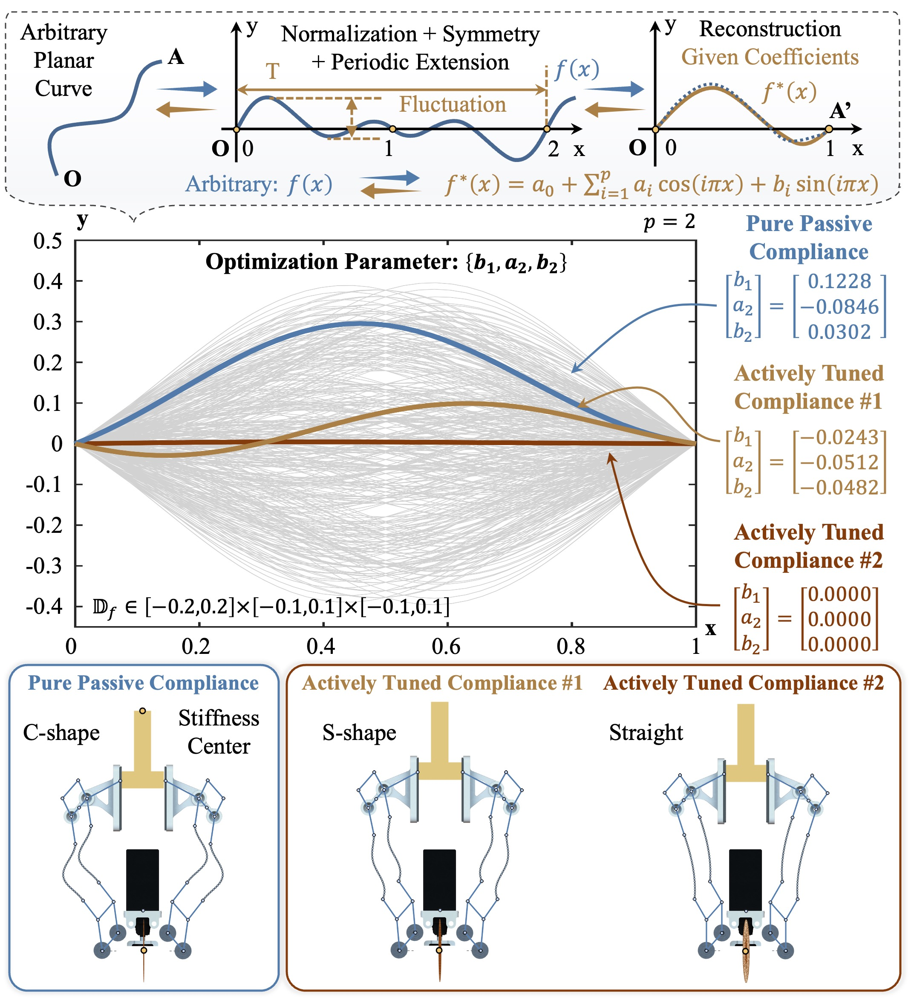</center>

### Optimization Results

Three optimization cases are investigated:

**Pure Passive Compliance:** The optimal beam geometry is a **C-type curve**. The operating point is defined by extending from the grasping point along the central axis. The z-coordinate of the compliance center alters from 185.15 mm to 261.68 mm with a range of 76.53 mm, indicating that the compliance center can reach twice the characteristic length from the grasping point. The rotational stiffness at the compliance center is 16.2 Nm/rad under maximum axial stiffness.

**Actively Tuned Compliance (Straight Beam):** The optimal beam geometry is close to a straight line. The axial stiffness variance ratio is **587.82×**, and the corresponding grasping stiffness variance is **100.4×**.

**Actively Tuned Compliance (S-type Beam):** With an additional constraint requiring maximum curve fluctuation greater than 10% of total length, the optimal result corresponds to an **S-type curve** with maximum fluctuation of 7.38 mm. The axial stiffness variance ratio is 2.98×, but the rotational stiffness magnitude is much smaller, making the two results possess their own advantages.

### FEA Verification

Finite element analysis is carried out to compare with the modeled results, validating the accuracy of the proposed stiffness modeling method across different beam geometries and materials.

<center>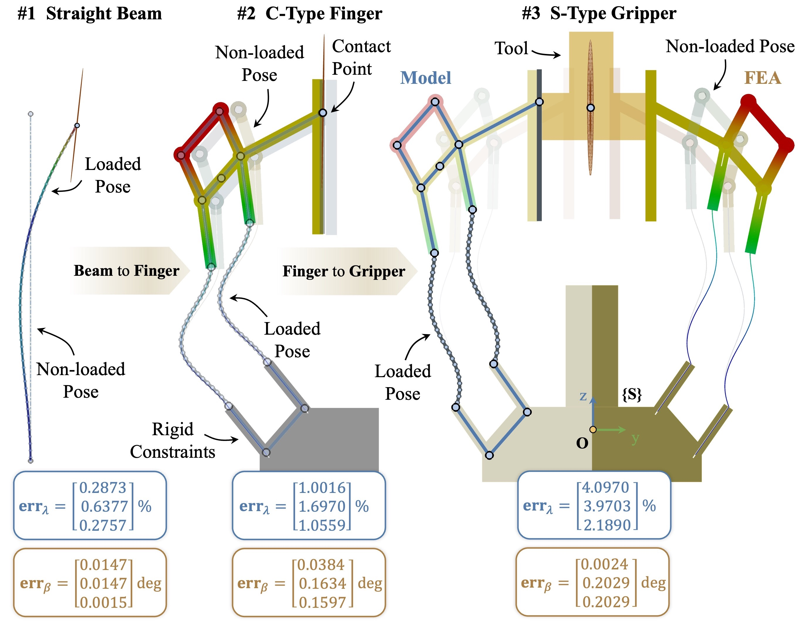</center>

## Experiments

### Validation Setup

The validation experiment setup consists of a position measuring system and force/torque sensors. The tip end of the tool is pushed with a variety of increments from various directions to construct a set of motion and force increments. Based on the measured increments, the measured stiffness matrix is synthesized using the least square method.

<center>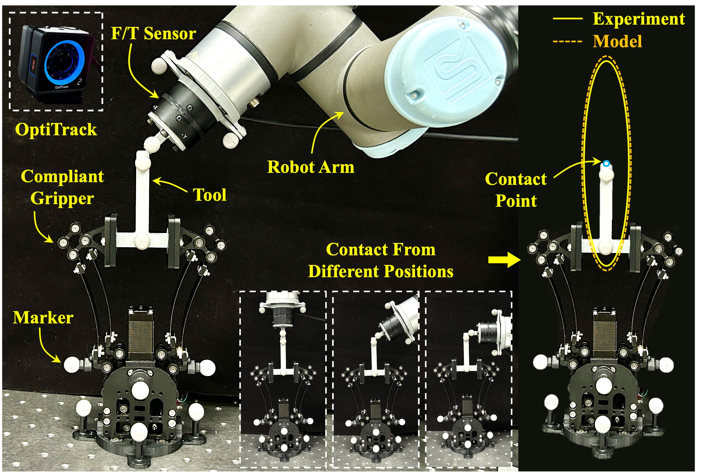</center>

### Stiffness Model Validation

To validate the generalizability of the proposed method, grippers with elastic beams of distinct materials and geometries are tested. Four cases are targeted:
- Straight beams made of **CF** (0.3 mm thick)
- Straight beams made of **SS** (spring steel)
- **C-shape** beams made of **PLA** (1.8 mm thick)
- **S-shape** beams made of **PLA** (1.5 mm thick)

12 groups of motion and force increments are applied for each case. The maximum errors are:
- **CF straight beam**: 1.8247 N force, 0.1261 Nm torque
- **SS straight beam**: larger errors due to larger principal stiffness
- **PLA C-shape**: 1.1007 N force, 0.0385 Nm torque
- **PLA S-shape**: 1.6059 N force, 0.0665 Nm torque

The experimentally derived and modeled Cartesian stiffness ellipsoids show good agreement, validating the effectiveness of the proposed method.

<center>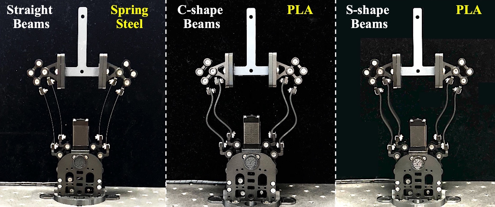</center>

<center>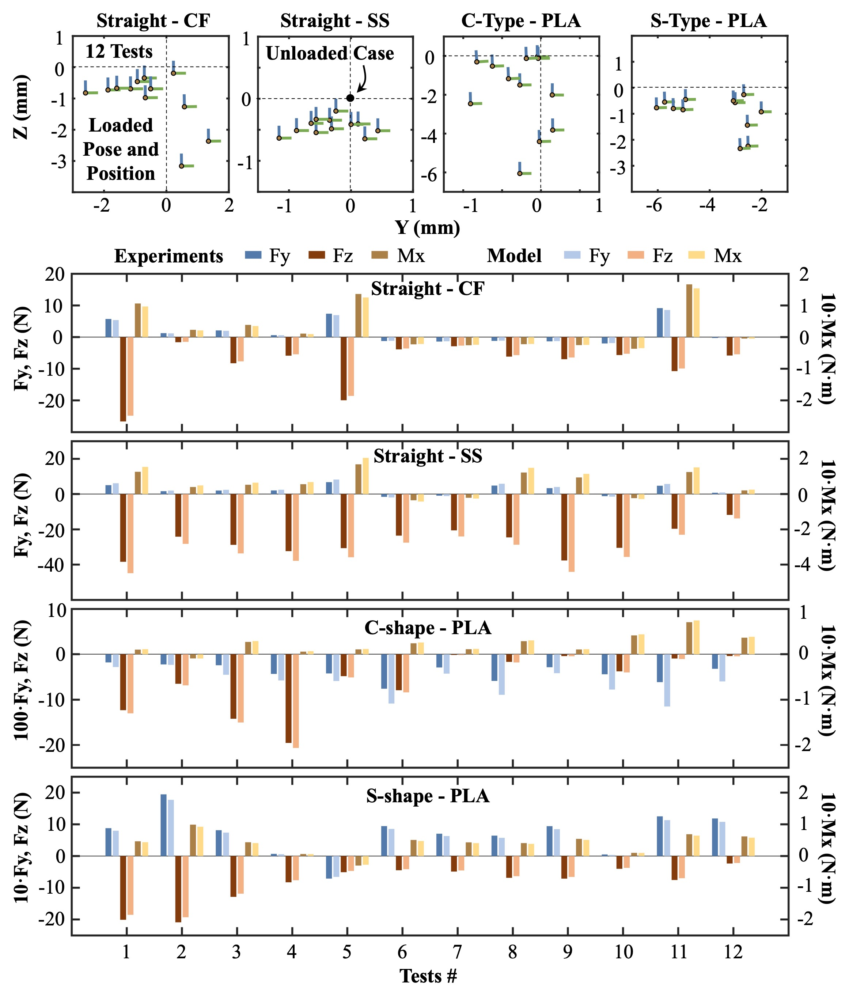</center>

### Grasping Demonstration

The grasping scenarios of the designed compliant gripper are demonstrated, handling diverse objects with distinct properties, including a soft sponge, a rigid brick, a light bolt, and a heavy stone. This reveals the potential usage of the proposed compliant gripper in practical applications.

<center>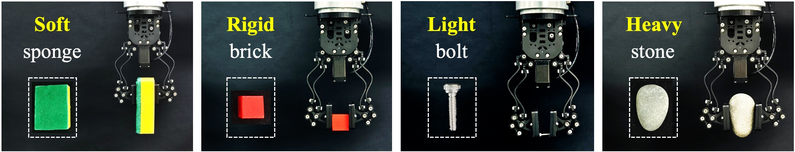</center>

### Peg-into-Hole Assembly

A validation for the gripper with pure passive compliance is demonstrated using the optimal C-shape beams. For the autonomous peg-into-hole task, several orientation and position errors are intentionally introduced by the robot arm, including a **5° orientational deviation** and a further **3.5 mm positional deviation**.

During the pegging process, the tool overcomes these deviations and adapts to the hole passively, without active control, despite slight rotational motions being induced at the tip of the tool. Compared with rigid grippers that damage the tool due to errors, the proposed compliant gripper effectively showcases benefits in flexible assembly tasks.

<center>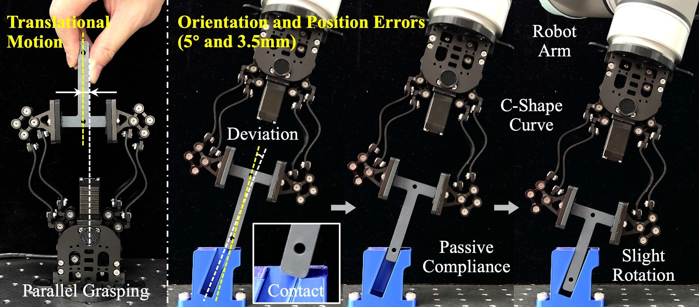</center>

## Video Demonstration





## Paper

<center>
<a href="TMECH_Gripper.pdf" class="home-social-btn" target="_blank" style="display:inline-flex; align-items:center; gap:6px; padding:10px 24px; border:1px solid #d0ccc2; border-radius:24px; background-color:#fff; color:#555; font-size:0.9rem; text-decoration:none; transition:all 0.2s ease;">
    <svg viewBox="0 0 24 24" width="18" height="18" fill="currentColor"><path d="M14 2H6a2 2 0 0 0-2 2v16a2 2 0 0 0 2 2h12a2 2 0 0 0 2-2V8l-6-6zm-1 7V3.5L18.5 9H13z"/></svg>
    Download Paper (PDF)
</a>
</center>

**Citation:**
```
@article{yao2025variable,
  title={Modeling and Optimization of A Variable Stiffness Compliant Gripper with the Flexible Parallelogram Mechanism},
  author={Yao, Siyue and Yuan, Hao and Wu, Chenhao and Wang, Yanjun and Wang, Hao and Chen, Genliang},
  journal={IEEE/ASME Transactions on Mechatronics},
  year={2025}
}
```
